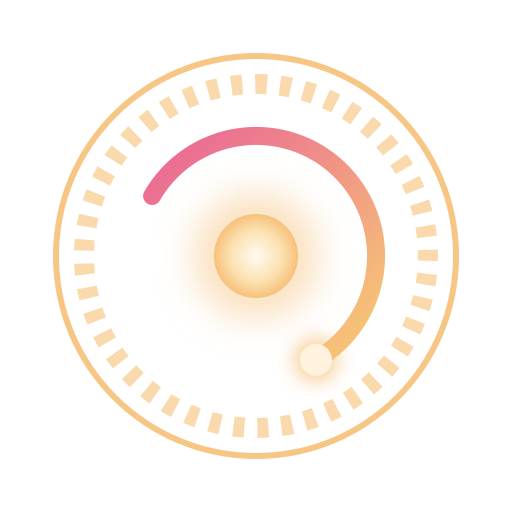
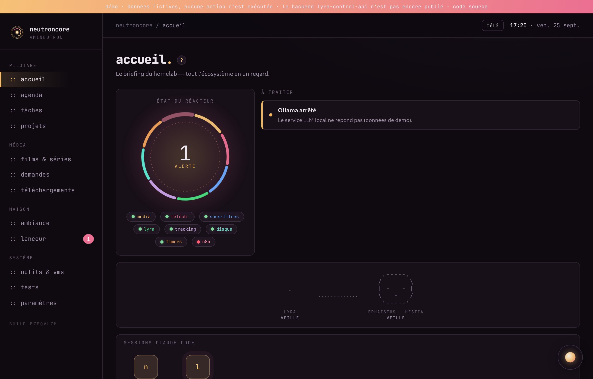
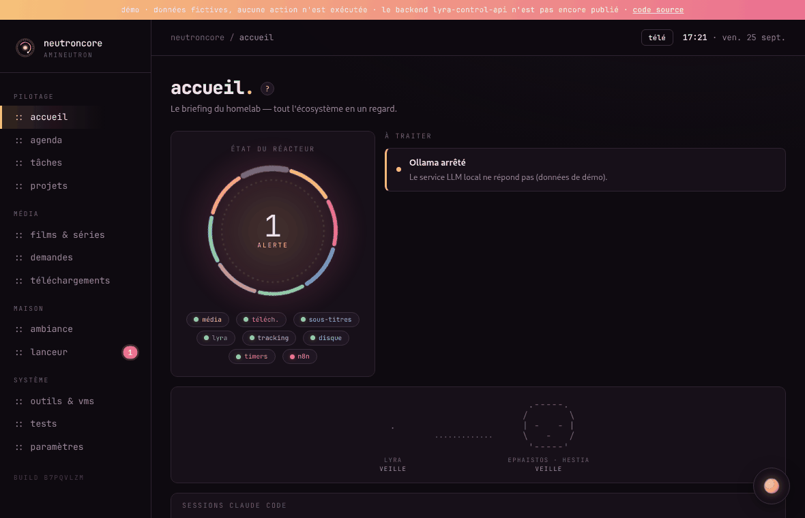
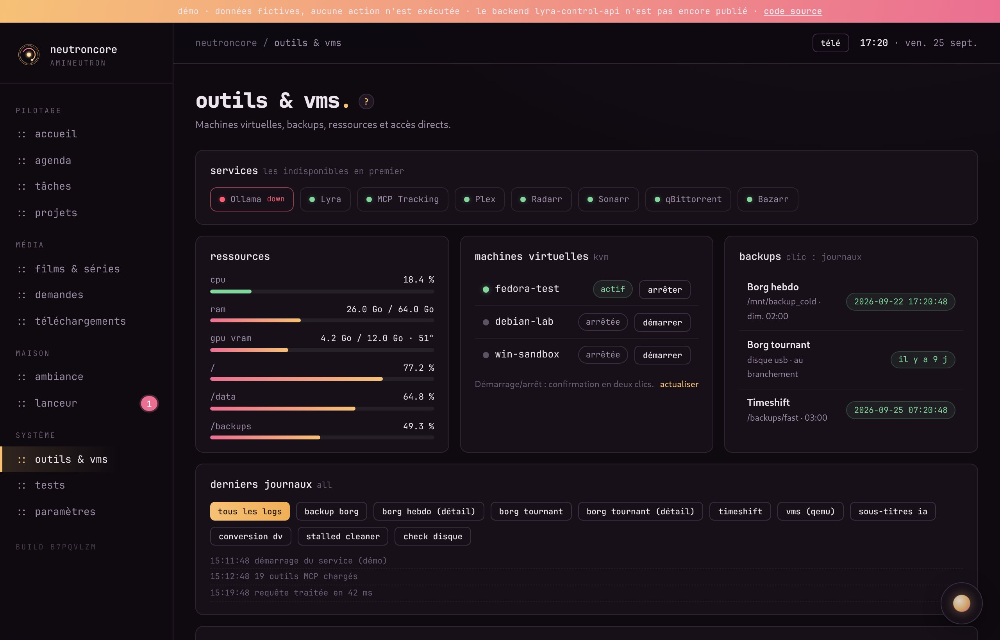
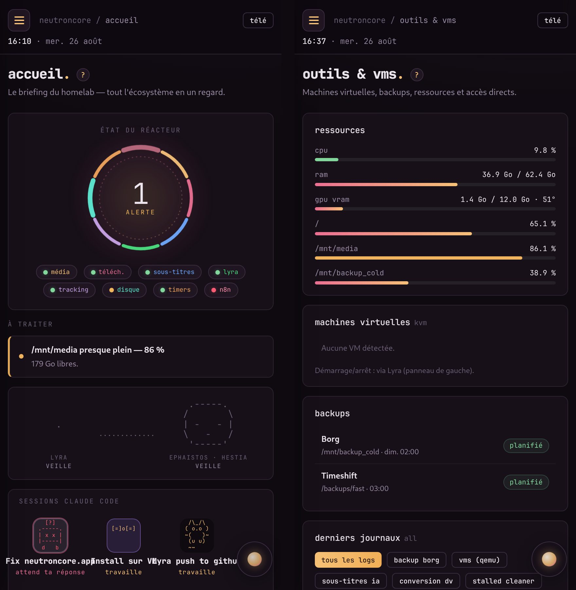
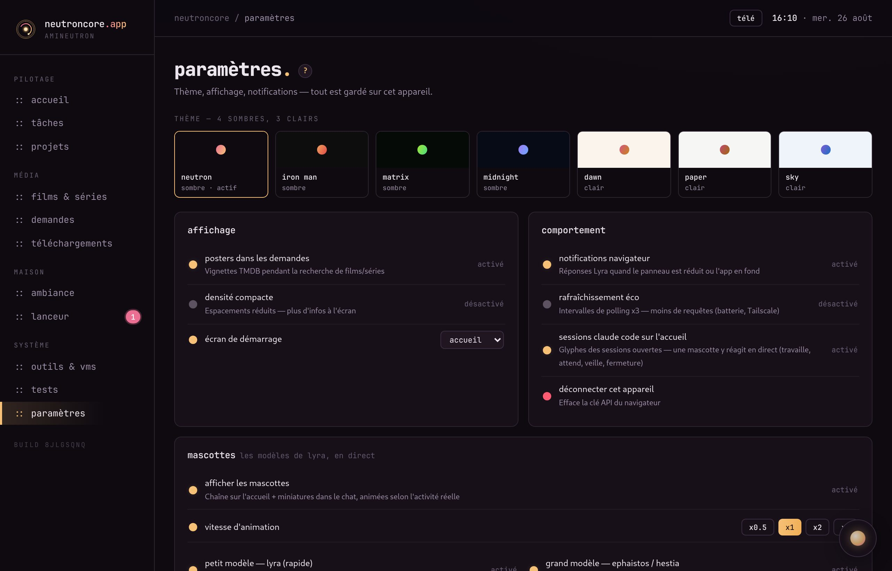

<p align="center">
  
</p>

<h1 align="center">neutroncore</h1>

<p align="center">
  Le hub de mon homelab en une seule interface : etat des services, taches de fond,
  mediatheque, domotique et sessions Claude Code, pilotees par Lyra.<br>
  PWA React + coque Android (Capacitor), servie par <code>lyra-control-api</code> et accessible depuis le telephone via Tailscale.
</p>

<p align="center">
  <a href="https://amineutron.github.io/neutroncore/"><b>Essayer la démo en ligne</b></a> : données fictives, aucun backend, rien n'est exécuté.
</p>

<p align="center">
  
</p>

**English summary.** neutroncore is the PWA hub of a self-hosted homelab: services, background tasks, media library, home automation, tracked projects and Claude Code sessions, driven by the Lyra assistant. React 19 + Vite + TypeScript, no UI library, served by the (not yet published) lyra-control-api backend. **Try the live demo** (fake data, no backend): https://amineutron.github.io/neutroncore/. See [ARCHITECTURE.md](ARCHITECTURE.md).

## Demo



Toutes les images de ce README viennent de la [demo en ligne](https://amineutron.github.io/neutroncore/) : meme code, donnees fictives (aucune donnee de la machine n'est publiee). Elles sont regenerees par [`docs/demo/capture_demo.py`](docs/demo/capture_demo.py) (Chrome sans fenetre via Playwright, assemblage Pillow) apres `npm run build:demo`. [`docs/demo/record.py`](docs/demo/record.py) capture l'application reelle servie par `lyra-control-api`, a relire avant toute publication.

## Mode demo (sans backend)

La demo publiee sur GitHub Pages est le meme code compile avec `VITE_MOCK_API=1` :
aucune requete reseau, les reponses viennent de `src/mock/` (donnees inventees :
films du domaine public, images ISO Linux, chemins `/home/user`), et les actions
sont simulees. Le chat Lyra repond avec un scenario fixe.

```bash
npm run build:demo     # dist-demo/, base /neutroncore/
npm run check:demo     # refuse le bundle s'il contient une IP locale, un chemin perso ou un e-mail
npm test               # routeur de demo et coherence des donnees (vitest)
```

Dans le build normal (`npm run build`), la constante de compilation retire le code
et les donnees de demo du bundle. Le workflow `.github/workflows/pages.yml` publie la
demo a chaque push sur `main`, apres les tests et `check:demo`.

## Ce que ca fait

Les ecrans sont ranges en quatre groupes, comme dans le menu. Chacun a un bouton `?` qui l'explique.

| Groupe | Ecran | Contenu |
|---|---|---|
| pilotage | accueil | "etat du reacteur" (sante globale), alertes a traiter, mascottes des modeles Lyra, sessions Claude Code et boucles de l'atelier en cours |
| | agenda | evenements, rotations, automatisations planifiees |
| | automatisations | QUAND / SI / ALORS en blocs ou en diagramme, catalogue ferme d'actions, historique de chaque passage |
| | taches | tracking temps reel (sessions Lyra, conversions DV, scripts), journal, timers systemd |
| | projets | projets suivis, mises a jour, branches & PR des depots |
| | atelier 3d | modeles d'un pipeline de modelisation : vue 3D (eclate, coupe, fantome), controles, iterations d'une boucle d'agents, plans, materiaux, montage pas a pas, videos |
| media | films & series | mediatheque, calendrier des sorties, manquants, espace disque |
| | demandes / telechargements | demandes, watchlist, telechargement, sous-titres, conversion : avancement en direct |
| maison | ambiance | lumieres Hue, TV (telecommande), ampli, routines |
| | camera | webcam detouree (flou, fond prefait ou importe) publiee comme camera de l'ordinateur pour la visio |
| | lumiere 3d | effets de lumiere dans l'espace (onde, mur, maree, phare, raz de maree...) cales sur la musique : pad de scenes, sets, reglages propres a chaque effet, apercu sur une piece 3D, puis les vraies lampes Hue |
| | plan de piece | position des lampes, de la TV et du ruban LED, vue de dessus et en 3D |
| | lanceur | ouvrir un dossier ou lancer Claude Code sur le PC depuis le telephone, suivre et repondre aux sessions |
| systeme | outils & vms | services, ressources (CPU/RAM/VRAM/disques), VMs KVM (démarrage / arrêt confirmés en deux clics), backups Borg/Timeshift, journaux |
| | tests | batteries de tests des projets |
| | parametres | 7 themes, densite, notifications, mascottes, mode tele, tutoriels |

Un tutoriel guide la premiere ouverture (relancable depuis les parametres), et `Ctrl+K` ouvre une palette de commandes.

<p align="center">
  
</p>

## Architecture

Vue détaillée dans [ARCHITECTURE.md](ARCHITECTURE.md).

```
telephone (APK Capacitor)  --Tailscale-->  lyra-control-api (:9876)  -->  Lyra, MCP, systemd, stack media...
navigateur (PWA)           --------------->      sert dist/ sur /app/
ntfy (docker, IP Tailscale uniquement)  <--  notifications push (Claude attend / a fini, alertes)
```

- **Frontend** : React 19 + Vite + TypeScript, design system maison dans `src/styles.css`, aucune lib UI.
- **Backend** : `lyra-control-api` (Python), depot separe, **pas encore publie** (il le sera apres audit). Sans lui, l'interface demande sa cle API ; pour l'essayer sans backend, voir le mode demo ci-dessous.
- **Auth** : cle Bearer saisie au premier lancement (localStorage) ; actions destructives protegees par un jeton HMAC 30 s a usage unique (`X-Confirm`).
- **Android** : la coque charge directement l'URL du backend sur le tailnet, donc `npm run build` suffit pour mettre a jour le telephone, sans recompiler l'APK.

<p align="center">
  
</p>

## Lancer

```bash
npm install
cp .env.example .env.local        # hote media, IP Tailscale, tailnet
npm run dev                       # proxy /api -> http://127.0.0.1:9876
npm run build                     # dist/ servi par lyra-control-api sur /app/
./neutroncore-app.sh              # fenetre bureau flottante (chrome --app)
```

### Elements facultatifs

Seuls le frontend et `lyra-control-api` sont necessaires. Tout le reste est facultatif : sans lui, l'ecran
concerne le dit et le reste de l'app fonctionne (verifie en lancant l'API dans un dossier vide : aucune
route ne repond en erreur 500).

Ranges par groupe du menu :

| Groupe | Element | Ce qu'il apporte | Ce qu'il lui faut | Sans lui |
|---|---|---|---|---|
| tous | Daemon Lyra | chat, TV, ampli, Hue, VMs, action « demander a lyra » des automatisations | `LYRA_SOCKET` | « daemon Lyra injoignable », ecrans vides |
| pilotage | Tracking | taches de fond | service sur le port 8765 | service affiche « arrete » |
| pilotage | Branches & PR | etat des depots suivis | depots sous `DEV_ROOT`, `gh` | seuls les depots presents sont suivis |
| pilotage | Atelier 3d | modeles, iterations, plans | projet de modelisation (`MODELISATION_ROOT`), Claude Code et kitty pour lancer la boucle | liste de projets vide |
| media | Stack media | films, series, demandes, telechargements | conteneurs *arr, qBittorrent | « cle API introuvable » sur ces ecrans |
| maison | Camera | detourage, camera virtuelle | `CAMERA_PYTHON` (torch, OpenCV), module v4l2loopback (`CAMERA_SORTIE`), webcam (`CAMERA_SOURCE`) | bandeau « pas installee », bouton sans effet |
| maison | Lumiere 3d sur les vraies lampes | effets cales sur la musique | pont Hue avec une zone Entertainment, hue-mcp et huebeat (`HUE_BEAT_PYTHON`, avance reglable par `HUE_BEAT_AVANCE_MS`) | pad, sets et apercu sur la piece 3D restent utilisables |
| maison | Plan de piece | positions des lampes et du ruban | fichier de plan de HALO | piece par defaut, sans lampes |
| maison | Sessions Claude Code | lanceur, reponses, notifications | Claude Code, kitty, hooks | liste vide |
| tous | Notifications telephone | push quand Claude attend | ntfy (`NTFY_URL`, `NTFY_TOKEN`) | pas de push, le reste inchange |

Les automatisations, l'agenda, les parametres et la palette de commandes n'ont besoin de rien d'autre que l'API.
Les variables se mettent dans l'environnement du service qui les lit (`lyra-control-api`, ou hue-mcp pour celles de huebeat), jamais dans ce depot.

### APK Android

```bash
./build-apk.sh            # genere AndroidManifest.xml et network_security_config.xml
./build-apk.sh --install  # depuis les templates .in + .env.local, puis gradle + adb
```

Les fichiers Android qui contiennent des adresses (manifest, config reseau) ne sont pas versionnes :
ils sont regeneres a chaque build depuis les templates `*.in` et ton `.env.local`.

### Notifications push (ntfy)

`ntfy/` contient un `docker-compose.yml.example` et un `server.yml.example` : ntfy auto-heberge,
ecoute uniquement sur l'IP Tailscale du PC, acces refuse par defaut, un utilisateur + jeton.
Voir `ntfy/README.md`.

<p align="center">
  
</p>

## Secrets

Aucun secret dans le depot : cle API cote client en localStorage, jetons ntfy et cles des services
lus par le backend depuis `~/.lyra-control.env` et `systemd-creds`. Les IP/tailnet sont dans `.env.local` (gitignore).

## Licence

MIT

## Part of the Lyra ecosystem

| Dépôt | Rôle |
|---|---|
| [lyra](https://github.com/amineutron/lyra) | assistant DevOps vocal, local par défaut (AGPL-3.0) |
| [fedora-agents](https://github.com/amineutron/fedora-agents) | MCP : machines virtuelles KVM et sauvegardes |
| [mcp-tracking](https://github.com/amineutron/mcp-tracking) | MCP + API + tableau de bord des tâches longues |
| [neutroncore](https://github.com/amineutron/neutroncore) | hub PWA du homelab |
| [hue-mcp](https://github.com/amineutron/hue-mcp) | MCP Philips Hue (fork de ThomasRohde/hue-mcp) |
| [pylips-mcp](https://github.com/amineutron/pylips-mcp) | MCP TV Philips |
| [denon-mcp](https://github.com/amineutron/denon-mcp) | MCP ampli Denon |
| [catt-mcp](https://github.com/amineutron/catt-mcp) | MCP Chromecast et DLNA |
